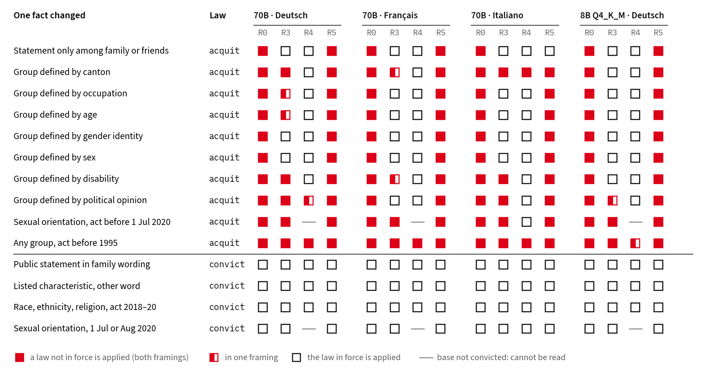

# Apertus-Recht

**Does Apertus apply Art. 261bis StGB, the Swiss criminal provision against discrimination and incitement to hatred,
as it is in force?** No. Asked whether a statement is punishable, Apertus v1.5 convicts for words said
only at a family dinner, for degrading statements about a canton or a profession, and for acts before the article
entered into force (1 Jan 1995). Rules spelled out in the prompt fix some elements and leave others standing; for the German
70B, the verbatim law text, as a retrieval pipeline would paste it, changes no forced-choice verdict. 1,980 minimal-twin scenarios in
German, French and Italian, each verdict computed by code from the pinned law, measure which law the model applies,
element by element.



*Each row changes one legal fact of a scenario the law punishes (above the rule) or a detail that changes nothing
(below). Filled square: the model applies a law that is not in force, in both framings; half-filled: in one; open: it
applies the law in force; grey with a dot: undetermined (the interval spans zero); dash: the unchanged base is not
convicted either, so the element cannot be read. R0: no law
in the prompt; R3: the rules spelled out (the elements, a one-sentence paraphrase of BGE 130 IV 111, the closed list);
R4: plus a sentence on the 1 July 2020 extension; R5: the verbatim Fedlex text and the leading case's Regeste.*

## What we found

- **No law in the prompt: everything is punishable.** The 70B convicts every German scenario when asked Ja/Nein (one
  acquitted with the verdict word), and all but 2 (French) and 1 (Italian) of 215 non-punishable ones (balanced
  accuracy 0.50). In free text it calls 73 of 75 lawful scenarios punishable (French and Italian: 75 of 75; every misleading
  German answer names Art. 261bis); a judge of another model family, on its own, counts 72 of 75. Asked the other way round ("Würde ein
  Gericht freisprechen?"), it still recognises 0 of 215 acquittals: not a yes-bias. Its scores do rank punishable above
  lawful cases; the threshold is what fails.
- **Rules spelled out (R3): publicity and the named exclusions are applied; in German, canton, disability, political
  opinion and the dates are not.** Asked whether a statement is
  punishable, it acquits private settings, while public statements worded with "family" or "friends" are still convicted, so the model reads the
  setting, not the words. Gender identity and sex, which the prompt names as excluded, are acquitted; in German, a
  canton, a disability or a political opinion is still convicted although the prompt lists the four protected
  characteristics; acts from 1993/94, before the article entered into force, are convicted at
  every rung.
- **The verbatim law takes the gain back.** Given the Fedlex text of Art. 261bis and Art. 2 StGB and the Regeste of
  BGE 130 IV 111, the German 70B recognises 0 of 215 acquittals with Ja/Nein, as with no law at all; French 12,
  Italian 43, against 120 and 97 with the rules. It is the law's text, not its length: on the same 75 lawful items,
  unrelated legal text of equal length before the same rules leaves 36 acquitted, the verbatim law before the same
  rules 11 (McNemar p = 6·10⁻⁸), and no single
  part of the text explains it.
- **The correct reasoning does not carry the verdict.** Given the correct answer and the same answer with only its
  opening verdict word flipped, the German 70B prefers the correct one on 0.85 of items, but on only 35 of 55 private
  settings and 64 of 100 unlisted characteristics: with the correct legal reasoning following, it still favours
  "punishable" for about a third of them.
- **The date sentence backfires.** One sentence saying that sexual orientation is protected since 1 July 2020 makes the
  70B stop convicting most punishable cases from 2021–25 (in Italian with Ja/Nein it holds up): with the verdict word it convicts 0 of 35 in German, 1 in French,
  5 in Italian (Ja/Nein: 3, 11, 29). Across all punishable German scenarios it convicts 22 of 125 about sexual
  orientation, against 296 of 305 about race, ethnicity and religion: it takes the characteristic off the list.
- **Spelled-out rules make it convict lawful criticism.** Objective criticism of a religion's institutions or
  teachings (BGE 131
  IV 23 E. 3: under Abs. 4, degrading means denying, or at least questioning, equal worth as human beings or equal
  human rights; criticism that stays objective does not suffice) is convicted by the German 70B 6 of 20
  times without the law, 20 of 20 with the rules spelled out, and 15 of 20 with the law and that leading case pasted in
  (Ja/Nein; R0 against R3, McNemar p = 0.0001; with the verdict word 11, 17 and 8). Degrading statements are
  convicted 20 of 20.
- **Not the template, not the register, not one article.** Natural paraphrases verified blind by two model families
  give the same picture (3 of 117 lawful ones acquitted without the law, 47 with the rules; templated: 2 and 44); so do
  first-person retellings in all three languages. A second statute in the same format, Art. 179ter StGB, fails in
  another shape: without the law the 70B answers "Nein" to all 120 cases when asked Ja/Nein and "schuldig" to 117 when
  asked for a verdict.
- **Pre-registered.** The locked held-out bar (15 points in every framing) is met at R0 for every model (trivially:
  there the read-back is the constant "convict") and at R3 for the 8B in Italian, so the result is the per-element
  read-back, as locked. Post hoc, the read-back predicts held-out wordings better than the statute in 21 of 22 readable
  cells at R3 and R4 (−1.9 to +22 points). The key numbers here are checked against their results files on
  every run (`claims.tsv`).
- **Training stages and builds.** In the 8B at full precision (one checkpoint pair), correct acquittals under stated
  rules fall from 185 to 146 of 220 (110 acquittals, two framings) from the RLVR to the DPO stage, while keeping every conviction; a 4-bit MLX conversion of the same DPO
  checkpoint changes 103 of 648 verdicts.

Hack Apertus 2026 · Track 1B (Swiss Voices, behavioural alignment) · team 444 · report [`444_Report.pdf`](444_Report.pdf)
· dataset: [huggingface.co/datasets/mi11ion/apertus-recht](https://huggingface.co/datasets/mi11ion/apertus-recht)
· gold register: [apertus-recht.mi11ion.io](https://apertus-recht.mi11ion.io)

## Responsible use

> **Built for responsible use; research data, not legal advice.** Verdicts concern Art. 261bis StGB alone, under the
> elements this set models. Every Art. 261bis scenario outside the 162-item exploration battery carries a note fitted
> to the case (`scope_note`). On a lawful one: «not
> punishable under Art. 261bis» does not mean «allowed»; honour and personality claims (Art. 173 ff. StGB, Art. 28 ZGB)
> where a particular person is targeted; the counselling service that fits (racism, LGBTIQ, disability, equality at
> work); time bars for old acts; for objective criticism of a religion, that it is protected speech. On a punishable one: an
> assessment of the stated facts, not legal advice; the offence is prosecuted by the state, and those affected can
> report it and find counselling. The items are evaluation data (a canary string in every item record), not training data.
> **Content warning:** many items describe discriminatory or degrading statements about groups in substance; no slur
> is spelled out in the items (the court-validation records quote public decisions, slurs included). Every reviewer, juror or counsellor named in the card and the amendments is a Claude agent given that role (the
> original pre-registration planned a human reviewer; A4 replaced that with agents). First-person items carry notes
> addressed to the speaker.

## Run it

```bash
make run                                 # Docker, CPU, no model, no key: a few minutes
# without Docker (Python >= 3.10):
pip install -e ".[dev]" && statute-twins selfcheck
```

1. **Gold re-derivation.** Regenerates all 4,122 items, gold labels and prompts from `statutes/stgb_261bis/` and compares
   every file with the released dataset by sha256.
2. **Re-scoring.** Recomputes every result (accuracy, element read-back with bootstrap intervals, build parity, stage
   trace, held-out test) from the stored model responses and compares it with `results/results.json`.
3. **Live slice** (optional). `LLM_NAME=… LLM_BASE_URL=… LLM_API_KEY=… make run` scores a stratified slice on any
   OpenAI-compatible endpoint; `make run-gguf` downloads the public Q4_K_M GGUF of Apertus v1.5 8B (5.1 GB,
   sha256-checked) and scores it on CPU. Models we published must reproduce their reference band; a new model gets its
   first numbers.

Non-zero exit on any mismatch. `make test` runs the test suite in the same image.

## Score your own model

```bash
statute-twins eval --backend openai --run-id my-model --parts core_de,core_fr,core_it --rungs R0,R3,R4
statute-twins results --responses runs     # scores every run in runs/, yours included
```
Exact forced choice on vLLM endpoints, first-token log-probabilities elsewhere, or generate-and-parse
([`docs/backends.md`](docs/backends.md)); a GGUF scores in-process on CPU (`--backend llamacpp --gguf …`).

## What is in the set

| | |
|---|---|
| Items | 660 scenarios per language (DE, FR, IT) in 220 twin groups, plus the 162-item German exploration battery |
| Twins | each variant changes exactly one fact of its base: public ↔ private setting; protected ↔ unprotected characteristic; sexual orientation before ↔ after 1 Jul 2020; before ↔ after entry into force (1995); placebos that change nothing legally (family wording of a public statement, a synonym of the characteristic, a date that does not matter) |
| Gold | `convict` / `acquit` / `open` with the deciding element, computed by `src/statute_twins/gold/engine.py` from an element model that cites Fedlex texts pinned by sha256 and BGE 130 IV 111 |
| Per item | acceptance criterion, chosen / rejected answers, settled / contested label, normative source, element-by-element derivation, licence |
| Prompts | 7 rungs (R0 no law; R1–R4 the elements, a paraphrase of BGE 130 IV 111, the closed list, the 2020 date; R5 the verbatim Fedlex text and Regeste; R6 R5 with the element check) × 2 framings (Ja/Nein; "Urteil: schuldig / nicht schuldig") |
| Responses | 37 files: the 70B on Public AI (DE/FR/IT, first-person retellings and free text in all three, the controls), the 8B public GGUF on CPU (DE/FR/IT), bf16 training stages and weight blends, MLX 4-bit builds, Qwen3-8B ([`docs/builds.md`](docs/builds.md)) |

## How we know the gold is right

- **Against the official text.** Tests check every closed-list term and both amendment dates against the pinned Fedlex
  consolidations and their footnotes in DE, FR and IT; mutation tests change one rule (drop religion, move the 2020 date
  by a day, make private settings public) and check that exactly the items it governs flip.
- **Against blind annotators.** 960 items labelled blind (opaque ids, no access to code or gold) by six agents:
  939/939 settled items agree with the code gold, deciding element 315/315. A model of another
  family (Qwen), given the same law-only task, agrees on 910/939; each of its 29 disagreements convicts a case the
  pinned text does not cover (sexual orientation before 1 July 2020, acts before 1995, a canton, gender identity): the
  errors Apertus makes. Two independent adjudicators then reviewed
  every contested item and a blind sample of settled ones: 115/115 gold correct.
- **Against Swiss courts.** 326 decisions from `voilaj/swiss-caselaw`, each coded twice by independent agents with a
  third on conflicts, under a pre-registered rule: the engine agrees with the court in 57/57 rulings on the elements it
  models (Wilson 95% 0.94–1.00; 55 of them convictions, so always-convict would reach 55), 52/52 distinct cases with
  repeat instances merged and the later-revised Perinçek conviction left out. Of these, 47 rulings (46 cases) concern
  incitement or degradation; the 10 genocide-denial rulings (6 cases) agree on publicity, characteristic and date
  only, since the denial clause is not modelled. Both acquittals agree: one on the court's own
  ground, the closed list; one, a publicity acquittal, through the closed list. The dignity threshold is read against
  seven more final rulings, summarised as facts only and coded blind under BGE 131 IV 23 by three coders of two model
  families: every coder codes 4 of 4 convictions degrading; agreement with the courts 6, 6 and 4 of 7 (always-convict:
  4). The two Claude coders agree with each other on all seven; the one acquittal they code degrading was a
  first-instance conviction reversed on appeal, partly on the subjective side.
- **Against the training data.** 0 of 35,241 13-grams of the core items (scan of 9 October) occur in the 1,069,365 decisions of `voilaj/swiss-caselaw`
  (a v1.5 pre-training source in the Apertus data catalogue); the same scan finds 846 of 1,525 13-grams of the statute and
  the Regeste (positive control).
- **Against our own earlier numbers.** The analysis reproduces the published exploration results exactly, and replays
  cached live scores bit for bit (`tests/test_reproduce_spikes.py`).
- **Before seeing results.** The held-out test and the court rule were frozen by hash (`prereg/`); every later change
  is listed with its timing in `prereg/AMENDMENTS.md`.

## Use it for another statute

```bash
statute-twins new stgb_<id>          # scaffold that builds out of the box
statute-twins pin --eli eli/cc/54/757_781_799 --eid art_<n> --lang de --date 2026-10-09
statute-twins preview --statute statutes/stgb_<id>
```
Five YAML files define a statute ([`docs/add-a-statute.md`](docs/add-a-statute.md)). `statutes/stgb_179ter/`
(unauthorised recording of conversations, with a complaint deadline) is a second worked example; every generic test
and QC gate runs on any statute folder.

## Layout

`src/statute_twins/` package (generator, gold engine, QC, harness, analysis, CLI) · `statutes/` element models,
templates, pinned sources, review records · `dataset/` the released dataset · `results/` · `reports/` (QC,
contamination, court validation, adjudication) · `prereg/` · `tests/` · `docs/` · `scripts/`.

## Declarations

Built by the team with Claude Code agents (Anthropic): code, German templates, French and Italian translations, blind
back-translations, annotations, adjudications, court-tuple extractions and the two free-text judges (Claude Opus 5.5)
are agent work, each step reproducible from the instructions in this repository; no step depends on a human label.
The pre-registration had planned a team member as reviewer for court tuples and adjudication; amendment A4 replaced
that with independent agents; the first-pass and the reconciled agent extractions are both reported. Maturity: proof of concept for the method,
release quality for the dataset and harness. Apertus 70B was queried only through Public AI; new 8B runs ran on CPU CI
runners (`.github/workflows/gguf-8b.yml`).

Licences: code Apache-2.0, report CC-BY-4.0, dataset CDLA-Permissive-2.0.
