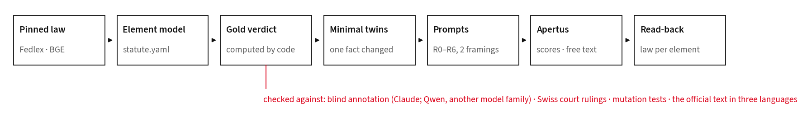
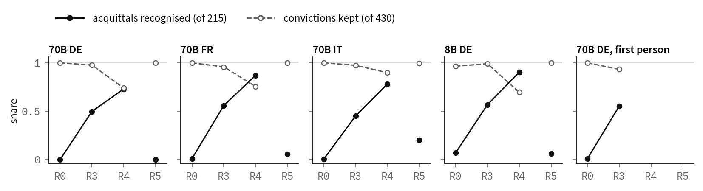

# Apertus-Recht: which racial-discrimination law does Apertus apply?

People ask chat assistants whether something they said is punishable. We release 1,980 German, French and Italian
scenarios under Art. 261bis StGB, built as minimal twins that change one legal fact at a time. Intent and the dignity
threshold are stipulated, so the set tests how a model applies the elements, not whether it predicts a conviction.
Each verdict is computed by code from pinned Fedlex texts and agrees with ⟨court_ofk⟩ Swiss court rulings we could
code (mostly convictions: an engine that always convicts would score 55). Without the law, Apertus v1.5 70B convicts
all but at most one of the 215 lawful German scenarios and, in free text, calls ⟨open_r0_mislead⟩ of 75 lawful scenarios punishable. Rules spelled out in plain sentences make it apply the publicity rule, but not the closed list
of protected groups or the date the article took effect. Pasting the verbatim law undoes even that. On a second statute
(Art. 179ter), its answer without the law follows the wording of the question, not the facts. One command re-derives every label and number.

**Track:** Apertus Readiness · Track 1B (Swiss Voices, behavioural alignment) · **Event:** Online · **Team:** 444  
**Demo:** https://apertus-recht.mi11ion.io (every scenario, its gold and Apertus's answers) · `make run` (Docker, CPU, no key)

----

### Use of Apertus

- **Model:** Apertus v1.5 70B; Apertus v1.5 8B (public Q4_K_M GGUF; for exploration also the SFT, RLVR, DPO and final
  stages, bf16 blends, Q8_0 and MLX 4-bit builds).
- **How it is used:** evaluation only: forced choice, preference pairs, and free text read by three blind judges.
- **Where it runs:** the 70B on Public AI through a cost-capped gateway (see Runs for the endpoint name); the 8B as
  the public GGUF on CPU in CI.
- **Links:** code https://github.com/mi11ione/apertus-recht · dataset https://huggingface.co/datasets/mi11ion/apertus-recht

----

## Use Case Description

Art. 261bis StGB [1] punishes racial discrimination; since 1 July 2020 it also covers sexual orientation. Whether a
statement is punishable turns on three elements a layperson cannot check:

- **Publicity.** Under BGE 130 IV 111 [2] E. 5.2, statements among family, friends or in a setting of personal trust are
  not public.
- **The closed list.** Only race, ethnicity, religion and sexual orientation are protected.
- **The date.** The article entered into force on 1 January 1995; sexual orientation is covered from 1 July 2020.

A wrong answer misinforms people about their own speech, in either direction. The users are Swiss residents asking an
assistant in German, French or Italian, with or without the law in context (Apertus-v1.5-8B: ⟨hf_downloads⟩
downloads in the 30 days before 9 October 2026). The dataset asks not "how often is the model right" but **which law
it applies**, element by element.

## Dataset Summary

Per language: 660 scenarios in 220 twin groups (220 base, 215 true flips, 210 placebos, 15 contested); verdicts
430 convict, 215 acquit, 15 open. Each scenario has an acceptance criterion, an item-specific `chosen` answer, a
`rejected` answer and a length-matched mirror, a settled or contested label, its normative source and its
element-by-element derivation. The 660 German scenarios are also retold in the first person (`de_lay`).

| Term | Meaning |
|---|---|
| Twin | a variant that changes exactly one fact of its base. A *true flip* changes the verdict; a *placebo* does not. |
| Rung | how much law the prompt carries. **R0** no law · **R3** rules spelled out (the elements, a one-sentence paraphrase of BGE 130 IV 111, the closed list, and that gender identity and sex are not covered) · **R4** R3 plus one sentence on the 2020 extension · **R5** verbatim law (Fedlex text of Art. 261bis and Art. 2 StGB, the Regeste) · **R6** R5 with an instruction to check each element |
| Framing | how the verdict is asked: Ja/Nein, or the verdict word ("Urteil: schuldig / nicht schuldig") |
| Misapplied (red) | the model convicts a variant the law acquits, while it convicts the unchanged base (95% intervals); for a placebo, a change that should not matter, it stops convicting |
| Read-back | the law the model applies, element by element, read off the twins |

| Family (groups per language) | One-fact change of the base | Tests |
|---|---|---|
| SET (55) | public → private setting; placebo: family wording of a public statement | BGE 130 IV 111 E. 5.2 |
| CHAR (60), CHARX (20) | protected → unprotected characteristic; placebo: synonym ("Hautfarbe", "Glaube") | closed list |
| DATE_SO (35) | sexual orientation 2021–25 → before 1 Jul 2020; placebo: 1 Jul / Aug 2020 | AS 2020 1609, Art. 2 StGB |
| DATE_CTRL (25) | race, ethnicity, religion → 2018–20 (placebo) and → 1993/94 | over-application; entry into force |
| CONTESTED (15) | public → fact-dependent setting (gold `open`) | hedging |
| WORDING (10) | another wording family; another paragraph | wording invariance |

Unprotected characteristics: gender identity, sex, canton, occupation, age, disability, political opinion. The
wording is templated (18 act wordings, 29 settings, 33 group phrases; 44 words on average): that is the price of exact
twins.

**What is new.** To our knowledge no dataset lets one test which version of a real statute a model applies, element by
element, in the three official languages; the closest work asks when models apply the wrong law [5] (sources in
`docs/prior-art.md`):

| Dataset | Languages | Gold | One-fact twins | Real amendment dates | Checked against courts |
|---|---|---|---|---|---|
| LEXam [3] / SwissLegalEvals | DE, EN / DE, FR, IT | exam keys, LLM judges | no | no | no |
| LawShift [4] | ZH | expert metamorphic relations | yes | hypothetical revisions | no |
| TALD [5] | ZH | statute version cited in judgments | no | which version applies | from judgments |
| OpenExempt [6] | EN | solver over expert encodings | single-factor suites | one deadline rule | no |
| Multilingual HateCheck [7] | DE, FR, IT, … | by construction | templated contrasts | no (not legal) | no |
| **Apertus-Recht** | **DE, FR, IT** | **code from pinned Fedlex texts** | **yes, with placebos** | **1995, 2020, Art. 2 StGB** | **⟨court_agree⟩ rulings** |

## Data Collection Method

**No data was collected from people.** A seeded generator renders the scenarios from YAML templates. A 97-line engine
computes each verdict from a machine-readable element model of the statute (`statutes/stgb_261bis/statute.yaml`).
Every element cites a pinned source: the Fedlex texts of Art. 261bis before and since 1 July 2020 and of Art. 2 StGB in
three languages (sha256 of each text), the amendment footnotes, and the Regeste of BGE 130 IV 111. The engine, not the
author, labels each variant a true flip, a placebo or contested; the generator refuses to build if that disagrees with
the design. French and Italian were translated by Claude agents with the official terms, back-translated blind (0
critical findings) and localised by a lawyer-persona review (places in Romandie and Ticino, Swiss formulas).
Every change after the pre-registration is a timestamped amendment in `prereg/AMENDMENTS.md`, cited below as A1–A15.

**Verification without human labels.** Because gold is computed, review looks for errors in the code, the element model
or the wording. Every review step was done by Claude agents working blind on opaque ids, without code or gold.
- **Annotation:** six agents labelled 960 items; they agree with the code on ⟨ann_settled⟩ settled items and name the
  deciding element in 315/315 acquittals. A second pass that saw only the law agreed on 939/939. A model of another
  family (Qwen), given the same law-only task, agrees on ⟨qwen_gold⟩; each of its ⟨qwen_gold_dis⟩ disagreements convicts a
  case the pinned text does not cover (pre-2020 sexual orientation, pre-1995, unlisted characteristics): Apertus's own
  errors, not gold errors (A15).
- **Adjudication:** two independent adjudicators reviewed every disagreement, every contested item and a blind 10%
  sample. Gold was wrong in 0 of 94 sampled items.
- **Court validation:** ⟨court_triaged⟩ citing Art. 261bis were triaged and coded twice (Cohen's κ, agreement beyond
  chance, 0.83–0.98 per field). The engine agrees with ⟨court_agree⟩ in-scope rulings, ⟨court_cases⟩ distinct cases
  (repeat instances merged; the Perinçek conviction left out after the European Court of Human Rights found a violation
  of Art. 10 ECHR). This tests the conviction rules well and the acquittal rules thinly: an engine that
  always convicts would score 55/57. One of the two acquittals is clean; one agrees on another ground (A15).
- **Wording fixes:** two defects found before any result was analysed (A3), four after (A5); fixed, re-scored, archived.

## Dataset Details

**Quality gates** (`statute-twins qc`, all passing): schema; gold recomputed for every item; twin invariants; no
duplicates; language identity; canary; a PII scan of items, responses and metadata (0 hits). Tests check every
closed-list term and both in-force dates against the official text in three languages. Mutation tests (drop religion
from the list, move the 2020 date by a day, make private settings public) flip exactly the items each rule governs.

**Contamination.** None of our 35,241 distinct 13-grams occurs in the 1,069,365 decisions of `voilaj/swiss-caselaw`;
the same scan finds 846 of the 1,525 13-grams of the statute and the Regeste (positive control).

**Ethics and licensing.** No data subjects; CDLA-Permissive-2.0 with per-item licence components; legal texts are
public domain (Art. 5 URG); a consent form with an AI-use clause; a canary string in every item.

## Evaluation

Figure 1 traces an item from the pinned law to the read-back, and shows what checks the gold.

*Figure 1. From the pinned law to the read-back of the law a model applies; below, the checks on the gold.*

**Three measurements on one item set.**
- *Forced choice* (all items, R0 to R5, two framings): the log-probability of the convicting answer minus the
  acquitting one, exact on vLLM (prefilled answer), from the logits in llama.cpp.
- *Preference* (settled items, R0): the same scoring between each item's `chosen` answer and its mirror, the same
  sentence with the verdict and the deciding legal claim negated (median length ratio 1.0).
- *Free text* (the same 240 items in each language, R0, R3, R5, greedy): each answer is judged against its acceptance
  criterion by three blind judges. Two are Claude judges; they agree on ⟨open_judges_agree⟩ pass decisions
  (κ ⟨open_kappa⟩), which measures self-consistency of one model. The independent judge is Qwen-SEA-LION-v4-32B: it agrees
  with their consensus on ⟨judgec_agree⟩ (κ ⟨judgec_kappa_acq⟩ on acquittal and open items together: ⟨judgec_kappa_acquit⟩ on acquittals, but
  ⟨judgec_kappa_open⟩ on the contested items, where it disagrees with the Claude judges). A deterministic parser of
  each answer's verdict agrees on ⟨parser_agree⟩ settled answers. A seeded 20% sample is laid out for a human check.

**The read-back.** Each true flip is paired with its base, which the statute convicts. With 95% item-bootstrap
intervals of the mean log-odds of conviction, an element is *misapplied* when both lie above zero. A framing in which
the base itself is not convicted cannot be read. The pre-registered test fits the read-back on two wording families
and predicts the third; it passes if it beats the statute by at least 0.15 in every readable framing.

**Runs.** The 70B on Public AI (vLLM, temperature 0) in three languages at R0 to R5; the 8B public Q4_K_M GGUF
(sha256 `a037df8d…`) on CPU CI runners, German R0 to R5; preference on 645 settled items per language; free text on
720 answers per language; Art. 179ter (120 items); the 162-item battery for training stages. Every row records the
served model and a request hash; every hosted number is the 70B (Public AI's `apertus-v1.5-8b` name serves it: same
output as `-70b` on 760 of 792 prompts, a 16-GPU deployment, MMLU 84% vs 71%; `docs/builds.md`).

## Results

**Without the law, the 70B convicts nearly everything.** At R0 the recall of acquittals is at most 0.01 in every
language and framing (Table 2; Figure 2 shows every model by rung). Table 1 shows what this means for one twin pair. The model is not blind to the facts: its scores still rank punishable above lawful cases (AUC ⟨auc_r0⟩).
But the threshold sits so far on the convicting side that no case falls below it. Asking the other way round ("would a
court acquit?") changes nothing: ⟨rev_r0⟩ of 215 acquittals in every language, so this is not a bias towards "yes".
In free text the judges fail ⟨open_r0_mislead⟩ of 75 answers to lawful scenarios as misleading; every one names
Art. 261bis. The independent judge alone counts ⟨judgec_r0⟩ of 75.

⟨table:twin⟩

*Table 1. One twin pair (German, Apertus 70B): a speech at an authorised rally before about 300 people, and the same
words in a private message to her sister. Only the setting differs; the law convicts the first and acquits the second.
Red: an answer the law does not support. Apertus convicts the private message without the law (R0) and again with the
verbatim law (R5); only the rules spelled out (R3) fix it. Its free-text answer ("Yes, the woman's conduct is
punishable under Swiss law") is misleading for all three judges.*

⟨table:accuracy⟩

*Table 2. Balanced accuracy (mean of the recall of convictions and of acquittals; 0.50 = no discrimination), Ja/Nein /
verdict word, and the recall of acquittals at R3. The first-person retelling was run at R0 and R3 only.*

*Figure 2. Share of the 215 lawful scenarios acquitted (solid) and of the 430 punishable ones convicted (dashed), by
rung, Ja/Nein: the rules spelled out move every model; the verbatim law undoes it. The first-person retelling was
run at R0 and R3 only.*

**With the rules spelled out (R3), publicity is applied; the closed list and the date are not.** Figure 3 is the
read-back itself: the law each model applies, element by element (the pre-registered rule reports it per element
because the pre-registered held-out test fails: at R3 and R4 the read-back beats the statute in every cell, but not
by the 0.15 required; see the end of this section). It shows every model and language; for the German 70B:
- **Private settings** are acquitted. Every private variant names family or friends, the words of the paraphrase, so
  this shows uptake of a stated example more than application of BGE 130 IV 111.
- **Canton, disability and political opinion** stay red: convicted although the prompt lists the four protected
  characteristics. Gender identity is applied once the prompt names it as excluded.
- **The R3 gain is fragile.** Asked whether a court would acquit, the 70B also acquits half the punishable cases, and
  its scores rank the cases backwards (AUC ⟨r3_rev_auc⟩). Averaged over both question directions, private settings
  still hold; most other acquittals do not (Table 3).
- **The date sentence (R4) backfires.** One sentence saying that sexual orientation is protected since 1 July 2020
  makes the 70B acquit the earlier cases, but also stop convicting punishable cases from 2021–25: 0 of these 35 with the
  verdict word in German. The 8B convicts ⟨so8b_conv⟩ of 35 with Ja/Nein (⟨so8b_ver⟩ with the verdict word). The
  sentence does not teach the date; it takes the characteristic off the list.
- **Acts from 1993/94**, before the article entered into force, are convicted at every rung. No rung states the 1995
  date, so this is a gap in what the model knows.

**The verbatim law (R5) undoes the rules.** Given the Fedlex text and the Regeste, as a retrieval pipeline would paste
them, the German 70B convicts almost everything again: it acquits ⟨r5_acq_conv⟩ of the 215 lawful scenarios with Ja/Nein,
⟨r5_acq_ver⟩ with the verdict word. In French and Italian it acquits ⟨r5_fr⟩ and ⟨r5_it⟩ of the 215 lawful scenarios, against 120 and 97 with the rules
spelled out.
In free text, ⟨open_r5_mislead⟩ of 75 answers to lawful scenarios call them punishable. The scores do register the
facts (a private setting lowers the conviction score by 6.6 nats, from 14.7), but never below the threshold. No single
part of the law text explains it (Table 3).

*Figure 3. The law in force (column "Law") next to the law Apertus applies. Each row changes one legal fact of a
scenario the statute punishes (above the rule) or a detail that changes nothing (below); each column is a rung of one
model. Filled square: the model applies a law that is not in force (both framings, 95% intervals); half-filled: in one
framing; open: it applies the law in force; dash: the base itself is not convicted, so the row cannot be read.*

| Control | Result | What it shows |
|---|---|---|
| Question asked the other way ("would a court acquit?"), no law | Of 215 lawful scenarios, ⟨rev_r0⟩ are acquitted, in every language. | not a bias towards "yes" |
| The same, rules spelled out | German: the model now also "acquits" punishable cases (balanced accuracy ⟨r3_rev_bal⟩). Averaged over both directions, ⟨r3_avg⟩ of 215 lawful scenarios are acquitted, among them ⟨r3_avg_set⟩ of 55 private settings. | part of the R3 gain is answer format |
| The same in Italian | Of 215 lawful scenarios, none acquitted: every case is convicted. | the answer follows the question |
| What in the verbatim law hurts (75 lawful German scenarios, a stable sample of 80 twin groups) | Acquitted with the rules alone: ⟨r3_same⟩ of 75; with the rules after the verbatim law: ⟨r5a_same⟩; with the rules after unrelated legal text of the same length: ⟨r5e_same⟩. | not prompt length: the law's own text |
| Verbatim law plus an instruction to check each element (R6) | Of 215 lawful German scenarios, ⟨r6_acq⟩ are acquitted. | not a missing instruction |
| Free text in French and Italian | Of 75 lawful scenarios, misleading answers: French ⟨ft_fr_r0⟩ without the law, ⟨ft_fr_r5⟩ with it; Italian ⟨ft_it_r0⟩ and ⟨ft_it_r5⟩. | not a German-only effect |
| The same scenarios told in the first person, all three languages | Of 215 lawful scenarios, acquitted without the law: German ⟨lay_acq⟩, French ⟨layfr_r0⟩, Italian ⟨layit_r0⟩. With the rules: ⟨lay_r3⟩, ⟨layfr_r3⟩, ⟨layit_r3⟩ (charge sheet: 107, 120, 97). | not an artefact of legal register |
| The same scenarios rewritten as natural text, facts verified blind by two model families | Of ⟨para_acq_n⟩ lawful scenarios (three languages, Ja/Nein): ⟨para_r0⟩ acquitted without the law, ⟨para_r3⟩ with the rules; the templated originals: ⟨orig_r0⟩ and ⟨orig_r3⟩. | not an artefact of templated wording |
| A second statute, Art. 179ter (120 German scenarios) | Without the law: "Nein" to all ⟨r179_r0_nein⟩ when asked Ja/Nein, "schuldig" to ⟨r179_r0_ver⟩ when asked for the verdict. With its elements and the complaint rule: balanced accuracy ⟨r179_r2⟩. | not specific to one article |

*Table 3. Controls (A13–A16; per-element detail in `reports/controls_a13.json`). Art. 179ter: even with its rules
stated, a public debate and an outsider (whose act falls under Art. 179bis) are still convicted.*

**Recognising the law is not applying it.** Shown an item's correct answer and its mirror, the 70B picks the correct
one (German ⟨pref_de_all⟩; Table 4), most cleanly in the closed-list and date columns, although its own verdicts
convict those cases. In French it prefers the mirror for half the punishable cases (0.53); we have not isolated why.

⟨table:preference⟩

*Table 4. Preference: share of settled items where the model scores the `chosen` answer above its length-matched
mirror. Free text: answers that meet the acceptance criterion (240 German items). Columns: the deciding element.*

**Pre-registered held-out test.** At R0 it passes trivially (a convict-everything model is predicted perfectly). At
R3 and R4 the read-back fitted on two wording families beats the statute on the third in every cell, but not by the
pre-registered 0.15 in every framing, so the test fails and the read-back is reported per element (Figure 3). Two
cells could not pass at all: the model departs from the statute on fewer than 15% of their items (French R3 verdict
word, Italian R4 Ja/Nein; largest possible gain 0.13 and 0.14). The split tests transfer to new wordings, not to new
legal facts. Every cell: `results/results.json` (`heldout`).

**Post-training and builds** (8B, the 162-item exploration battery). *Training stages* (one checkpoint pair, so a
lead): from RLVR to DPO, correct acquittals under stated rules fall from ⟨stage_rlvr⟩ to ⟨stage_dpo⟩ of 220 decisions,
while all 104 convictions are kept. *Builds:* of 648 decisions, the public Q8_0 GGUF matches bf16 on 638, the Q4_K_M
on 622, an MLX 4-bit conversion on 548.

## Dataset Limitations

- **Depth over breadth.** One statute modelled exactly, three of its five paragraphs. Intent, the characteristic and
  the dignity threshold are stated in the facts, where most court acquittals turn, so the set measures element
  application, not conviction prediction. A second statute (Art. 179ter) is released in the same five-file format.
- **Two contestable legal choices, stated.** An Abs. 2 act ("propagating an ideology") is also told as a one-off
  statement; an online post before 1 July 2020 counts as completed on publication (dropping those items moves no
  accuracy by more than ⟨sens_max⟩ points).
- **Every review is re-runnable** (agent runs with their instructions in the repository), and each is checked from
  outside one model family: the gold by Qwen, the official text, mutation tests and courts; the free text by Qwen and
  a parser. The wording is templated for exact twins; the first-person retelling shows the findings survive that.
- **Contested items are few** (15 per language); accuracy intervals treat items as independent.

## Lessons Learnt and Recommendations

- **Users:** do not ask about Art. 261bis without the law in context, nor count on pasting the statute. State the rule
  the case turns on in a plain sentence; check the characteristic and the date yourself; avoid 4-bit MLX conversions.
- **Developers:** in our one checkpoint pair, DPO costs acquittals under stated rules (8B: ⟨stage_rlvr⟩ → ⟨stage_dpo⟩ of
  220). The model obeys exclusions it is told but not "the list is closed", and reads plain rules but not the law as
  written: instruction-following and long-context legal reading are training targets. Keep the `chosen` / `rejected`
  pairs out of training if you evaluate on them.

## Reproducibility

`make run` (Docker, CPU, no key, no model) regenerates the dataset from the YAML (sha256 per file), recomputes every
result from the stored responses, checks every request hash against its prompt, re-aggregates the judges, checks the
pre-registration (`prereg-verify`: locked files, amendments A1–A15, the frozen held-out code) and the `claims.tsv`
numbers for both statutes, and exits non-zero on any mismatch. `LLM_*` variables or `make run-gguf` add a live slice.
Seeds: generator 261, bootstrap 0 (2,000 resamples). **License:** code Apache-2.0; dataset CDLA-Permissive-2.0; this
report CC-BY-4.0.

## References

[1] Swiss Criminal Code (StGB, SR 311.0), Art. 1, 2, 30, 31, 179ter, 261bis; Fedlex consolidations of 1 Feb 2020 and
1 Oct 2026; amendments AS 1994 2887 and AS 2020 1609. [2] BGE 130 IV 111 (Federal Supreme Court, 2004). [3] Fan et al.,
LEXam, ICLR 2026. [4] Han et al., LawShift, NeurIPS 2025 D&B. [5] Huang et al., When Do LLMs Apply the Wrong Law? (TALD), arXiv 2608.14610, 2026. [6] Servantez et al., OpenExempt, ACL
Findings 2026. [7] Röttger et al., Multilingual HateCheck, WOAH 2022.
